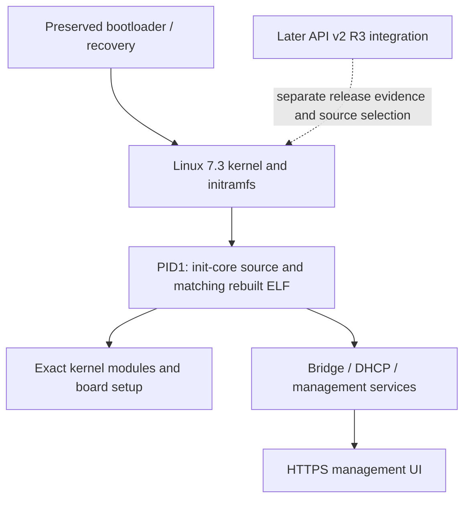

# HGW500 Linux 7.3 firmware reference and recovery

> Public source snapshot. [Scope, provenance and verification](docs/PUBLIC_SNAPSHOT.md).

This repository preserves the readable Core Boot R1 Linux 7.3 checkpoint: actual PID1 source, matching rebuilt ELF evidence, ARC disassembly, selected kernel/userland sources and sanitized container inventory. Despite the repository name, this checkpoint is not the later API v2 R3 integration release.

## How this component fits



This diagram shows software ownership and analysis flow, not a complete board schematic.
The [system architecture](docs/SYSTEM_ARCHITECTURE.md) explains the ARC750 host,
MuC, AuC, DSP and Realtek 8051, with their memory and firmware boundaries.

## What is established

| Area | Recorded scope |
| --- | --- |
| Preserved checkpoint | Core Boot R1, lyoko-linux73-core-boot-r1; kernel 7.3.0-openmitrastar-radio73-v1. |
| Exact PID1 | source/pid1/init-core-r1.c rebuilds to the recorded installed ELF SHA-256. Compile basename init-core.c is part of that reproducibility contract. |
| Container | The preserved RAS expands to kernel plus embedded newc initramfs; filesystem inventory is retained without exporting per-unit contents. |
| Later integration | API v2 R3 has a later source map, 46 packaged module entries and separately recorded installed acceptance. Core Boot R1 receipts do not qualify that newer image. |

## Start reading here

1. [Component handoff](docs/PROJECT_HANDOFF.md): inputs, evidence and next work.
2. [System architecture](docs/SYSTEM_ARCHITECTURE.md): processors and firmware families.
3. [Firmware contents](docs/FIRMWARE_MAP.md): OEM, Core Boot R1 and API v2 R3.
4. [Repository map](docs/REPOSITORY_MAP.md): host drivers, payloads and integration.
5. [Published checkout availability](docs/CHECKOUT_AVAILABILITY.md): actual remote source inventory.
6. [Preserved technical notes](docs/REFERENCE_NOTES.md): detailed earlier results, with workstation paths normalized.

## Work in progress

Keep this recoverable checkpoint intact while recording later integration separately. A complete rebuild needs the declared kernel context, rootfs/DT and separately provisioned private inputs. Do not relabel Core Boot R1 as R3 or treat a rebuilt PID1 as proof of a rebuilt whole image.

## Offline verification


```sh
python tools/verify_public_export.py
```

This checks the published file inventory. Original preservation verifiers and
receipts describe the private source checkpoint; they can require omitted native
databases or external inputs and are not a fresh public-snapshot qualification.

## Preservation and scope

This is a public source snapshot; per-unit data and original private histories remain private. Original vendor/GPL source, notices, comments,
carriers and immutable evidence retain their authorship and provenance. Derived
C is labelled as inferred analysis, not silently presented as original source.
Credentials, unit identity, calibration, personalized rootfs/flash images and
workstation-specific configuration stay outside documentation exports.

Documentation prepared 2026-11-10 from recorded source/evidence. No device access,
firmware installation, radio change or new physical qualification is implied.
